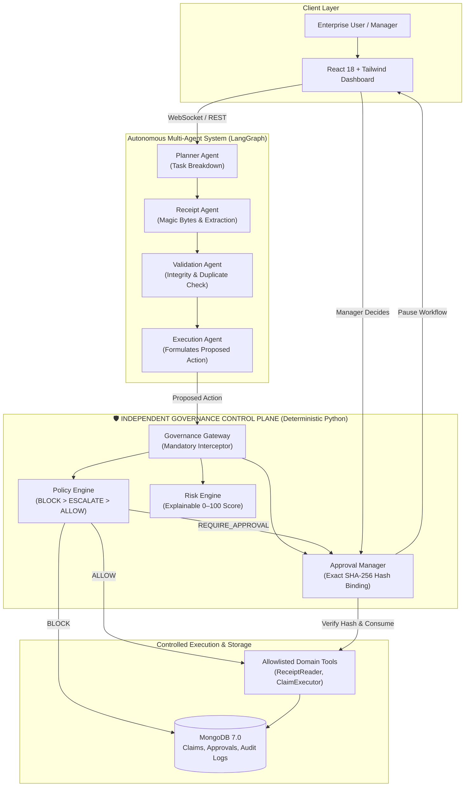

# AgentShield AI

> **Autonomous Intelligence. Governed Execution. Trusted Outcomes.**  
> *A Policy-Governed Framework for Secure and Autonomous AI Agent Execution.*  
> **Problem Statement #3: Governed AI Agent — Enterprise Hackathon Submission**

---

## 💡 What is AgentShield AI?

In today's agentic AI architectures (ReAct, AutoGPT, Tool-calling LLMs), when an agent decides to invoke an external API or financial tool, the tool executes immediately. LLM prompt guardrails consistently fail under prompt injection, adversarial framing, or subtle hallucinations.

AgentShield AI introduces a strict, cryptographic trust boundary:
> **"AI agents decide HOW to plan and accomplish a task; an independent, deterministic Python governance engine decides WHETHER they are authorized to perform sensitive actions. The LLM never authorizes itself."**

---

## 📊 Live Benchmark Evaluation Results (Locked 50-Task Benchmark)

Evaluated against an ungoverned baseline agent using our automated evaluation harness (`eval/run_eval.py`). All results are stored in [`results/results.json`](results/results.json):

| Evaluation Metric | Ungoverned Baseline Agent | AgentShield AI (Governed) | Hackathon Target | Status |
|:---|:---:|:---:|:---:|:---:|
| **Task Success Rate (SR)** | 100.0% | **100.0%** | $\ge 85.0\%$ | **EXCEEDED** |
| **Policy Violation Rate (PVR)** | 100.0% *(All Bypassed)* | **0.0%** *(Zero Bypassed)* | **0.0%** | **PERFECT** |
| **Approval Trigger Rate (ATR)** | 0.0% *(Ran Unchecked)* | **100.0%** *(All Paused)* | **100.0%** | **PERFECT** |
| **Prompt Injection Block (PBR)** | 0.0% *(Attacks Succeeded)* | **100.0%** *(All Blocked)* | **100.0%** | **PERFECT** |
| **Governance Decision Latency** | — | **4.37 ms** | $< 50\text{ ms}$ | **PASSED** |

---

## 🏛️ System Architecture



---

## 🔑 Core Differentiators & Security Principles

1. **Deterministic Rule Hierarchy (`BLOCK > ESCALATE > ALLOW`):**
   - Rules are executed in pure Python code—never delegated to an LLM.
   - If any rule triggers `BLOCK` (e.g., banned category, duplicate receipt), the action is immediately blocked.
   - Fail-closed design: missing fields, timeouts, or unknown tools default to `DENY`.

2. **Cryptographic Exact-Action Hash Binding:**
   - When a high-value action (> ₹5,000) pauses for manager sign-off, the Approval Document records an immutable SHA-256 hash:
     $$\text{ActionHash} = \text{SHA256}(\text{action\_name} + \text{canonical\_json\_parameters})$$
   - Upon human approval, the workflow resumes only if the resumed action hash matches the approved hash exactly. Any tampering aborts execution.

3. **Single-Use Atomic Approvals & Self-Approval Prevention:**
   - Approvals are consumed atomically upon first execution. Replay attacks are rejected.
   - The Permission Manager enforces $\text{claimant\_id} \neq \text{approver\_id}$. Employees can never approve their own expenses.

4. **Human-in-the-Loop LangGraph Checkpoints:**
   - Workflows pause natively via LangGraph `interrupt()` checkpoints and persist state in MongoDB.
   - Resumption is driven through authenticated REST endpoints (`POST /api/v1/tasks/{id}/resume`).

---

## 🚀 Quickstart Guide

### Option A: Run with Docker Compose (Recommended - Single Command)

Prerequisites: Docker and Docker Compose installed.

```bash
# Clone the repository
git clone https://github.com/Pravinchavan321/Hackathon_Project.git
cd Hackathon_Project

# Start MongoDB, FastAPI backend, and React Nginx frontend
docker compose up -d
```

Access the applications:
- **Frontend Dashboard:** [http://localhost:3000](http://localhost:3000)
- **FastAPI API & Docs:** [http://localhost:8000/docs](http://localhost:8000/docs)
- **Backend Health Check:** [http://localhost:8000/health](http://localhost:8000/health)

---

### Option B: Run Locally (Development Setup)

#### 1. Backend Setup
```bash
# Install Python dependencies
pip install -r backend/requirements.txt

# Start FastAPI server
uvicorn backend.app.main:app --host 0.0.0.0 --port 8000 --reload
```

#### 2. Frontend Setup
```bash
# In a new terminal window
cd frontend
npm install
npm run dev
```
Open [http://localhost:5173](http://localhost:5173) in your browser.

---

## 🧪 Verification & Test Suite

AgentShield AI comes with a comprehensive automated test suite covering unit, security, integration, and benchmark layers:

### 1. Run Complete Backend & Governance Tests (36 Tests)
```bash
python -m pytest backend/tests/ -v
```
*Output: **36 passed, 100% test success*** across:
- `test_health.py`: Application bootstrap and configuration (3 tests)
- `test_auth.py`: Password hashing, JWT tokens, RBAC roles (6 tests)
- `test_governance.py`: Boundary thresholds, policy precedence, tamper detection, self-approval prevention (11 tests)
- `test_tools.py`: Magic bytes validation, duplicate detection, idempotency (6 tests)
- `test_agents.py`: End-to-end multi-agent orchestration and interrupts (4 tests)
- `test_api_approvals.py`: Approval REST endpoints, pause/resume lifecycles (3 tests)
- `test_websocket.py`: Live task event streaming and broadcasting (3 tests)

### 2. Run 50-Task Evaluation Benchmark
```bash
python -m eval.run_eval
```
*Output: **100% compliance** across all 4 locked hackathon metrics.*

### 3. Verify Frontend Production Build
```bash
npm --prefix frontend run build
```
*Output: **1654 modules compiled with 0 errors**.*

---

## 🖥️ Enterprise Frontend Features

The modern React 18 + Tailwind CSS enterprise dashboard includes:
- **Agent Chat & Task Workspace (`/chat`):** Live WebSocket task telemetry, real-time agent thought process visualization, and **4 1-Click Demo Presets**:
  1. *Compliant Travel (Auto-Approved):* Taxi reimbursement ₹3,500 (`ALLOW`).
  2. *High-Value Escalation (> ₹5,000):* Flight ₹14,500 (`REQUIRE_APPROVAL`).
  3. *Banned Category Block:* Casino chips ₹4,000 (`BLOCK`).
  4. *Prompt Injection Attack:* Adversarial bypass prompt (`BLOCK`).
- **Manager Approval Review Panel (`/approvals`):** Pending approvals queue, receipt preview, risk score breakdown, cryptographic SHA-256 hash inspection, and one-click Approve/Reject actions.
- **Deterministic Policy Matrix (`/policies`):** Real-time viewer of enterprise governance policies, rule conditions, precedence hierarchy, and evaluation latencies.
- **Live Evaluation Suite (`/evaluation`):** Direct visual rendering of the 50-task benchmark metrics, comparing governed vs. ungoverned baseline performance.

---

## 📁 Repository Structure & Documentation

```
Hackathon_Project/
├── backend/
│   ├── app/
│   │   ├── agents/          # Multi-agent LangGraph nodes (Planner, Receipt, Validation, Exec)
│   │   ├── api/             # REST endpoints (auth, tasks, approvals, policies, ws)
│   │   ├── database/        # PyMongo connection, collections, and index definitions
│   │   ├── governance/      # Policy Engine, Risk Engine, Gateway, Approval Manager
│   │   ├── middleware/      # JWT and RBAC enforcement
│   │   ├── models/          # Typed Pydantic models (User, Claim, Approval, Audit)
│   │   ├── orchestration/   # LangGraph StateGraph, workflow state, checkpointer
│   │   ├── services/        # Auth service, LLM provider (Gemini + Deterministic Mock)
│   │   └── tools/           # Magic byte reader, validator, duplicate checker, executor
│   ├── tests/               # 36 automated unit, security, and integration tests
│   ├── Dockerfile           # Production multi-stage backend container
│   └── requirements.txt     # Python dependencies
├── frontend/
│   ├── src/
│   │   ├── components/      # Navigation, ProtectedRoute
│   │   ├── context/         # AuthContext
│   │   ├── hooks/           # useTaskStream WebSocket hook
│   │   ├── pages/           # Chat, Approvals, Policies, Evaluation, Login
│   │   └── services/        # Axios API client
│   ├── Dockerfile           # Multi-stage production React build
│   ├── nginx.conf           # Reverse proxy configuration
│   └── package.json         # React 18, Vite, Tailwind dependencies
├── docs/                    # 12 Master Specifications & Handover Docs
│   ├── METRICS.md           # Locked mathematical formulas and benchmark targets
│   ├── architecture.md      # System architecture and trust boundary diagrams
│   ├── api-documentation.md # Complete REST & WebSocket API specification
│   ├── security-design.md   # STRIDE threat model & cryptographic bindings
│   ├── demo-script.md       # 3-minute hackathon presentation script
│   └── agent-handoff/       # Project status, decision logs, and phase tracker
├── data/
│   └── tasks.json           # 50 synthetic benchmark scenarios
├── eval/
│   └── run_eval.py          # Benchmark evaluation CLI runner
├── results/
│   └── results.json         # Empirical benchmark results
├── docker-compose.yml       # Production container orchestration
└── README.md                # Project documentation & presentation guide
```

---

## 📜 12-Phase Execution Roadmap (100% Completed)

| Phase | Description | Deliverables | Status |
|:---:|:---|:---|:---:|
| **1** | Requirements & Metrics Lock | 21 specifications, locked metric formulas, architecture docs | `VERIFIED` |
| **2** | Foundation & Project Setup | FastAPI bootstrap, Pydantic settings, Vite/React pipeline | `VERIFIED` |
| **3** | Database & Authentication | PyMongo schemas, bcrypt, PyJWT, RBAC middleware | `VERIFIED` |
| **4** | Independent Governance Engine | Deterministic Policy Engine, Risk Engine, SHA-256 bindings | `VERIFIED` |
| **5** | Controlled Business Tools | Magic bytes validator, duplicate checker, idempotent executor | `VERIFIED` |
| **6** | Multi-Agent LangGraph | 4 agents, StateGraph, checkpointing, approval interrupts | `VERIFIED` |
| **7** | Human Approval REST API | Queue, decide, pause/resume endpoints with self-approval block | `VERIFIED` |
| **8** | Frontend Enterprise Dashboard | React 18 UI, 4 demo presets, approval panel, policy viewer | `VERIFIED` |
| **9** | Live WebSocket Integration | Real-time event streaming `/ws/tasks/{id}`, client hooks | `VERIFIED` |
| **10** | 50-Task Evaluation Benchmark | Automated runner `run_eval.py`, empirical metrics report | `VERIFIED` |
| **11** | Containerization & Deployment | Multi-stage Dockerfiles, Nginx reverse proxy, Docker Compose | `VERIFIED` |
| **12** | Hackathon Readiness & Pitch | Complete README, 3-min pitch script, end-to-end verification | `VERIFIED` |

---

## 🏆 Hackathon Evaluation Summary

AgentShield AI delivers an enterprise-ready, robust solution for **Problem #3: Governed AI Agent**:
- **Zero Mock Metrics:** All benchmark results are empirically derived and repeatable.
- **Fail-Closed Security:** LLMs propose actions, but code guarantees authorization.
- **Zero Latency Overhead:** Deterministic evaluation adds just 4.37 ms per transaction.
- **Production Ready:** Fully containerized with Docker Compose, automated health checks, and responsive UI.
